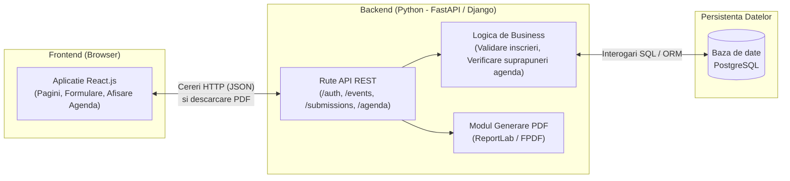

# Arhitectura Aplicatiei - UniMeet

Pentru proiectul **UniMeet** am mers pe o arhitectura clasica **Client-Server (3-Tier)**: un frontend separat (Single Page Application), un backend care expune un API REST si o baza de date relationala. Am ales varianta asta pentru ca ne permite sa lucram in paralel (unul pe interfata in React, celalalt pe server in Python) si sa comunicam prin JSON.

---

## 1. Diagrama Generala a Arhitecturii

---

## 2. Componentele Principale si Rolul Lor

### 2.1. Frontend (Client)
- Este dezvoltat in **React.js** (sau Vue.js, dar in principiu ramanem pe React).
- Se ocupa strict de afisarea paginilor, preluarea datelor din formulare (login, inscriere eveniment, trimitere lucrare, construire agenda) si trimiterea lor catre server.
- Nu face conexiune directa la baza de date; totul trece prin backend.

### 2.2. Backend (Server API)
- Scris in **Python** (folosind **FastAPI** sau **Django**).
- Se ocupa de:
  - **Autentificare si verificare roluri:** Verifica cine este logat (folosind token JWT sau sesiune) si daca are voie sa faca o anumita actiune (de exemplu, doar organizatorul are voie sa aprobe lucrari sau sa modifice agenda).
  - **Validarea regulilor aplicatiei:** Verifica daca mai sunt locuri la eveniment si daca nu exista suprapuneri de ore in aceeasi sala atunci cand se construieste agenda.
  - **Generarea diplomelor PDF:** La final, cand un participant trimite formularul de feedback, backend-ul compune un fisier PDF simplu cu datele din baza de date si il returneaza catre browser pentru download.

### 2.3. Baza de Date (PostgreSQL)
- Stocheaza toate datele structurate: conturile utilizatorilor, evenimentele, inscrierile, lucrarile trimise de speakeri, sloturile din agenda si raspunsurile de feedback.
- Legatura dintre Python si PostgreSQL se va face printr-un ORM (SQLAlchemy daca mergem pe FastAPI, sau ORM-ul integrat daca mergem pe Django), ca sa lucram mai usor cu tabelele direct din cod.

---
