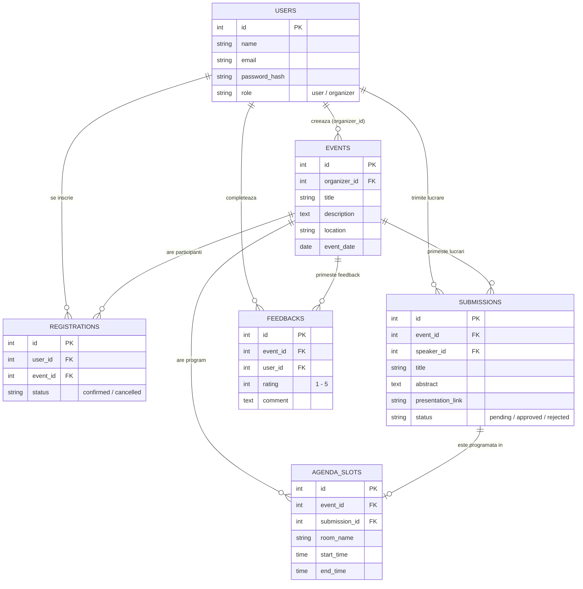

# Modelul Preliminar de Date si Endpoint-uri - UniMeet

Acest document descrie structura de baza a tabelelor pe care le vom folosi in **PostgreSQL**, precum si lista preliminara de rute (endpoint-uri) din backend. Pe masura ce scriem codul, este posibil sa mai adaugam cate o coloana ajutatoare daca vedem ca avem nevoie in interfata.

---

## 1. Diagrama Preliminara a Bazei de Date (Entitati si Relatii)

Pentru MVP sunt necesare `users`, `events`, `registrations` si `submissions`. `agenda_slots` si `feedbacks` sunt incluse in diagrama doar ca posibile extensii ulterioare.

---

## 2. Explicatia Tabelelor si a Relatiilor

1. **`users`:** Tabela cu toti utilizatorii. Campul `role` diferentiaza utilizatorii obisnuiti de organizatori; participarea ca participant sau speaker se alege pentru fiecare eveniment.
2. **`events`:** Evenimentele create de organizatori (`organizer_id` este cheie straina catre `users.id`).
3. **`registrations`:** Face legatura *Many-to-Many* intre utilizatori si evenimente pentru inscrierea ca participant. Emiterea certificatelor este o extensie optionala si nu necesita un camp dedicat in MVP.
4. **`submissions`:** Tabela pentru *Call for Papers* (lucrarile propuse de speakeri). Fiecare propunere este legata de un eveniment (`event_id`) si de utilizatorul care a trimis-o (`speaker_id`). Are coloana `status` care incepe ca `pending` si poate fi schimbata de organizator in `approved` sau `rejected`.
5. **`agenda_slots`:** Reprezinta randurile din agenda evenimentului. Fiecare slot se leaga de un eveniment si de o lucrare aprobata (`submission_id`), avand asociate o sala (`room_name`), ora de inceput si ora de sfarsit.
6. **`feedbacks`:** Stocheaza nota (1-5) si comentariul lasat de un participant la finalul evenimentului.

*(Nota: Ne-am gandit initial daca sa unim `registrations` cu `submissions` intr-o singura tabela, dar ni s-a parut mai curat sa le tinem separat, pentru ca un speaker are campuri in plus precum titlu, abstract si status de evaluare).*

---

## 3. Principalele Endpoint-uri API Propuse

Comunicarea dintre React si Python se va baza pe urmatoarele rute REST principale:

### Autentificare
- `POST /api/auth/register` - Creare cont nou.
- `POST /api/auth/login` - Autentificare (returneaza tokenul si rolul utilizatorului).

### Evenimente si Inscrieri
- `GET /api/events` - Returneaza lista tuturor evenimentelor pentru pagina principala.
- `GET /api/events/{id}` - Returneaza detaliile unui singur eveniment.
- `POST /api/events` - (Doar Organizator) Creeaza un eveniment nou.
- `POST /api/events/{id}/register` - Inscrie utilizatorul logat ca participant la eveniment.
- `GET /api/my-activity