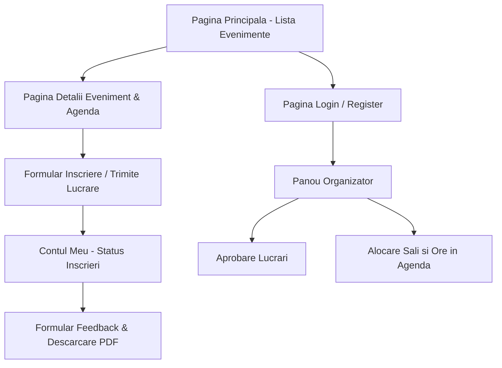

# Wireframe-uri si Fluxul de Navigare - UniMeet

Pentru aceasta prima etapa am schitat structura ecranelor principale (low-fidelity wireframes) si modul in care utilizatorul navigheaza intre ele. Designul exact (culori, fonturi, asezare finala) va fi ajustat pe parcursul implementarii in React.

Pentru MVP se implementeaza lista si detaliile evenimentelor, inscrierea/propunerea si administrarea propunerilor. Agenda, feedbackul si diploma din ecranele de mai jos sunt extensii ulterioare.

---

## 1. Fluxul de Navigare intre Pagini

---

## 2. Schite pentru Ecranele Principale

https://www.figma.com/design/fGlxlZaGQsC4myzmh6N8qe/Untitled?node-id=0-1&t=d6Ly2LoSPSfh8Z6p-1